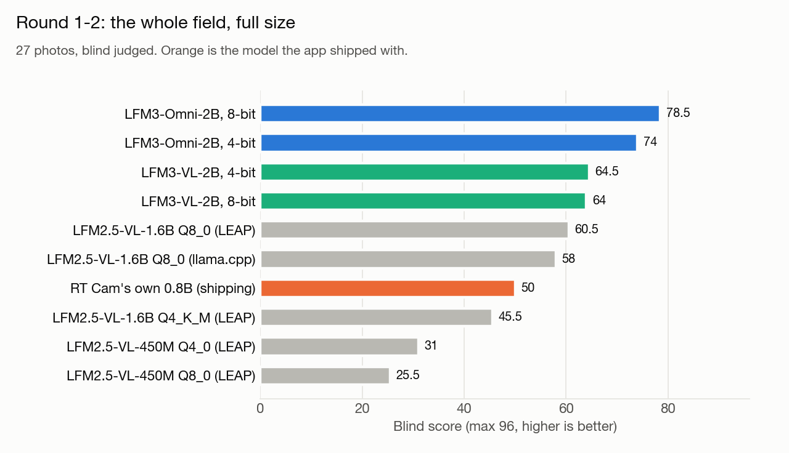
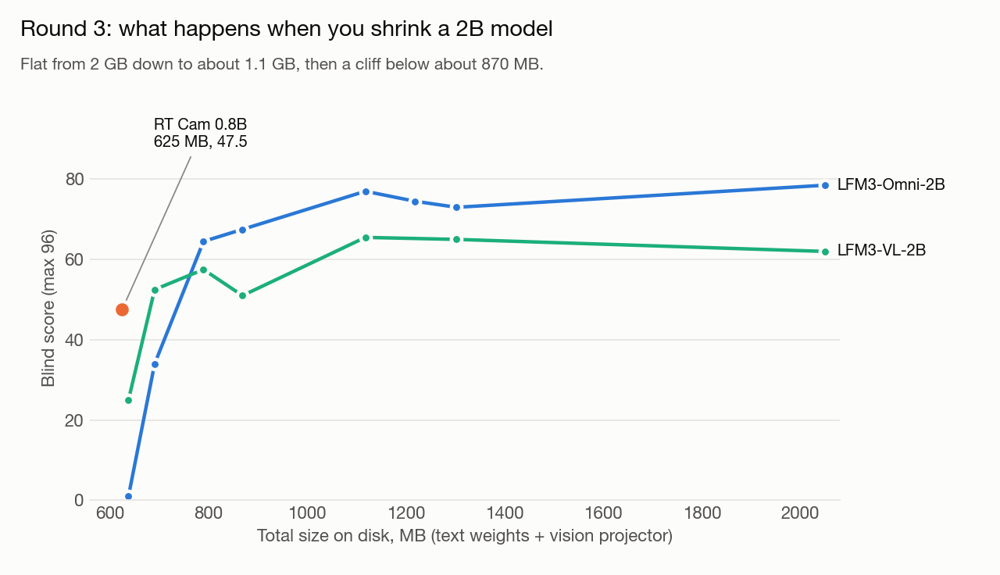
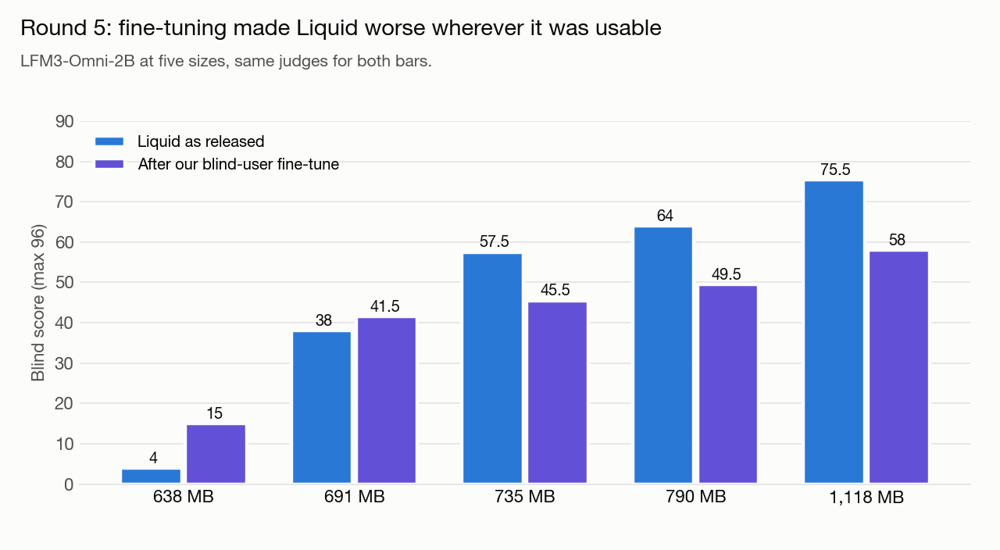
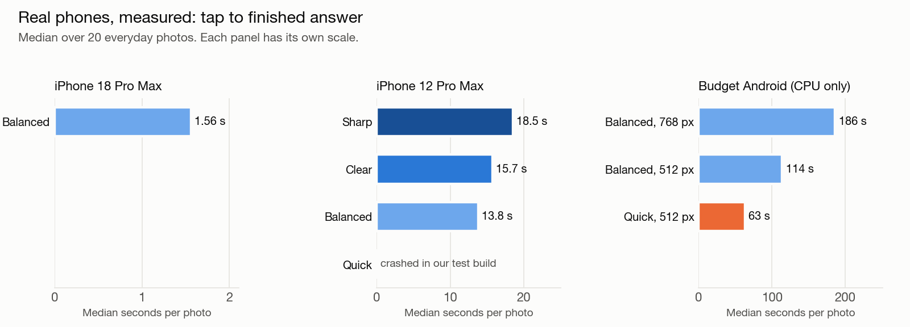
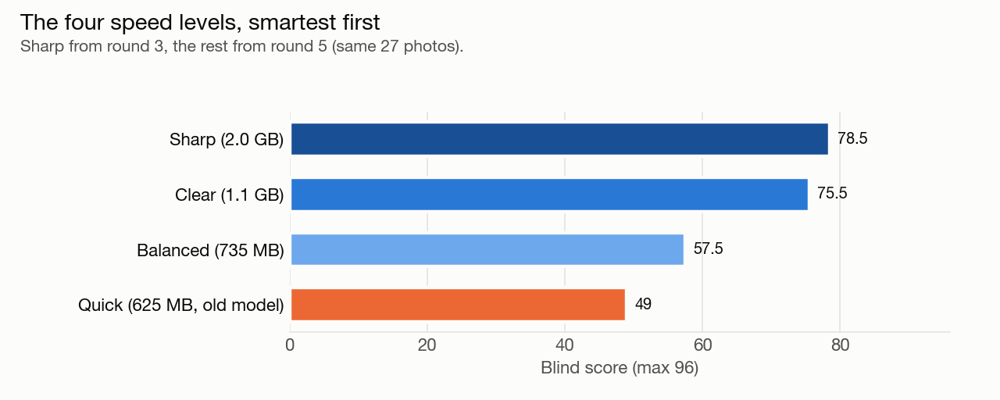

# How we pick the AI model for RealTime AI Cam

> **Living document.** Last updated 2026-10-30. Current app versions: iPhone 1.3.6 (in App Store review), Android 1.23 (built, release pending). This page changes every release; see the [changelog](#changelog) at the bottom.

**Summary.** We tested Liquid AI's new LFM3 vision models against the app's own 0.8B model on 27 photos of the things blind users point a phone at, judged blind with a safety-weighted rubric. LFM3-Omni-2B, as Liquid released it, was the most accurate and missed the fewest hazards, so it now replaces our old model in both apps at 735 MB. Fine-tuning it with our own data made it worse, and phones differ so much in speed that the app will soon pick its own model level per phone.

Raw scores and timings are in [`results/`](results/); photo credits are in [`photo-sources.md`](photo-sources.md).

## The question

RealTime AI Cam is an app that tells blind and low-vision people what is in front of the camera. It runs entirely on the phone, with no internet and no cloud. It ran on our own small model, a 0.8B vision model we fine-tuned for this one job. In October 2026 Liquid AI released LFM3, a new family of small vision models, and we wanted to know one thing: is there a better brain for this app, and can a normal phone run it?

This is how we tested it, what we found, and what we are shipping.

## Why we were careful

A blind user acts on what the app says. If it says the stairs go up when they go down, or misses a curb, or calls a fan of twenties "several denominations," that person can get hurt or lose money. So we did not want a leaderboard number or a demo that looks good on a nice photo. We wanted the model that gets the important facts right and misses the fewest hazards, on photos like the ones our users actually take.

## How we tested

**The photos.** 27 photos of the things blind users point a phone at: medicine labels, a nutrition panel, a receipt, money (a $1, a fan of $20s, euros), a distant road sign, a dark street, clutter, people, food, a laptop screen, exit doors, a curb ramp, a thermostat, traffic, a menu, an obstacle on the sidewalk and a restroom sign. 20 of them are license-free photos from Wikimedia Commons and 7 are photos provided by the developer. The 7 developer photos are not published, but their scores are.

**The rubric.** We wrote the rubric and the ground truth before running anything, from the photos alone. Each photo has 3 key facts (81 in total) and some photos have text that must be read right (15 in total). A model earns a point per fact and per text read correctly, loses a point for every invented detail, and loses 2 points for every safety miss: a hazard, a direction or a money detail that a blind user could act on wrongly. The best possible score is 96.

**Same input for everyone.** Every model got the app's exact system prompt and question, the same image sizes, the same rule for deciding whether a photo is a page to read or a scene to describe, a 120-token answer limit and a fresh conversation for every photo. Each model used its maker's own sampling settings. Timing is one warm-up and then the median of 3 runs.

**Blind judging.** For each photo, every answer was shuffled under a random letter. Separate AI judges scored them with the photo, the ground truth and the rubric in front of them, and never saw a model name. One judge scored every answer on a given photo, so no model got a softer judge than another. The key was opened only after all the scores were in.

**Anchors and controls.** In every new round we re-blinded a few answers from earlier rounds and scored them again. That tells us how much the judges drift from round to round (about 2 to 5 points), so we only compare rows inside the same round. Where we trained a model, we also ran the same model untrained as a control, and we checked that no training image looked like any test photo and that no test photo's text appeared in the training data.

**A second set.** To make sure the 27 photos were not a fluke, we also ran 20 everyday photos from the developer's own phone, with the ground truth written before reading a single answer. Those photos stay private; only their totals are published.

## Round 1 and 2: the whole field

We started with everything Liquid offers for vision, at full size, against the model the app shipped with.

| Model | Score (of 96) | Safety misses | Invented details | Size on disk | Answer time on a Mac |
|---|---|---|---|---|---|
| LFM3-Omni-2B, 8-bit | **78.5** | 1 | 3 | 2.7 GB | 0.73 s |
| LFM3-VL-2B, 4-bit | 64.5 | 2 | 0 | 1.6 GB | 0.31 s |
| LFM2.5-VL-1.6B, 8-bit | 60.5 | 2 | 4 | 1.8 GB | 0.40 s |
| RT Cam's own 0.8B | 50 | 5 | 5 | 625 MB | 0.21 s |
| LFM2.5-VL-450M, 4-bit | 31 | 4 | 15 | 322 MB | 0.24 s |

LFM3-Omni-2B was clearly the most accurate. It beat our model on 20 of the 27 photos and tied 3. Our model missed 5 hazards: it said the stairs led up, missed the curb ramp, missed the exit doors, called a fan of $20s "several denominations" and never said "euro." LFM3-VL-2B was the most careful of all, with zero invented details in 27 photos, but it read less text. Our model was the fastest and the smallest, and its short answers never ran on.

Liquid's smallest model, the 450M, is fast and tiny, but it was not good enough for this job. It invented 15 to 20 details and ran past the answer limit on most photos.

The catch: LFM3-Omni-2B is 2.7 GB at 8 bits, more than four times the size of our model. A big download and a big memory footprint lock out a lot of the phones blind users actually own.

## Round 3: how small can it go?

So we shrank it. We converted both LFM3 models to llama.cpp ourselves and quantized them step by step from 2 GB down to our model's 625 MB, then judged every size blind against our model.

| Total size | LFM3-Omni-2B | LFM3-VL-2B | RT Cam 0.8B |
|---|---|---|---|
| 2,049 MB | 78.5 | 62 | |
| 1,118 MB | **77** | 65.5 | |
| 869 MB | 67.5 | 51 | |
| 790 MB | 64.5 | 57.5 | |
| 691 MB | 34 | 52.5 | |
| 638 MB | 1 | 25 | |
| 625 MB | | | 47.5 |

From 2 GB down to about 1.1 GB the score barely moves. LFM3-Omni-2B at 1,118 MB scored 77 with zero safety misses, almost the same as the 2 GB build. Below about 870 MB it falls off a cliff. At our exact size the 2B models break: answers run on, invent text and miss hazards. A 2B model simply has too many weights to fit in 625 MB at a usable precision.

This was our own conversion with a general-purpose calibration set, not Liquid's published files. Liquid also publishes a quantization-aware 4-bit build that we did not test.

**Android, like for like.** Our Android app runs our model through llama.cpp at 737 MB, so we ran it through the same llama.cpp setup with the Android app's own settings. On llama.cpp against llama.cpp, Liquid won at every size from 790 MB up, by 9 to 32.5 points. Our model stayed about 3 times faster to the first word.

## Round 4: a fair fight at 2B

Maybe the gap was only about size: their 2B against our 0.8B. So we rebuilt our blind-user training recipe on Qwen3.5-2B, the same size class as LFM3, and ran a stock, untrained Qwen3.5-2B beside it as a control.

| Model | Size | Score (of 96) |
|---|---|---|
| LFM3-Omni-2B, untrained | 1,118 MB | **73** |
| Qwen3.5-2B, our recipe | 1,461 MB | 68 |
| LFM3-VL-2B, untrained | 1,118 MB | 67 |
| Qwen3.5-2B, stock | 1,461 MB | 66 |
| Qwen3.5-2B, our recipe | 1,099 MB | 56.5 |
| Qwen3.5-2B, stock | 1,099 MB | 54 |
| RT Cam 0.8B | 625 MB | 45.5 |

At the same size, Liquid's 2B was more accurate. Even with 31% more room, our trained Qwen only tied LFM3-VL. Our training added just 2 to 2.5 points over stock Qwen, which is inside the judges' noise, though it did make the answers cleaner (fewer invented details and no runaway answers). Qwen also could not get as small: its larger vocabulary and vision tower put its smallest sane build at about 1 GB.

## Round 5: what if we train Liquid?

The obvious next move was to put our blind-user training onto LFM3-Omni-2B itself, then shrink it to app size. We expected a win. We got the opposite.

| Size | Liquid as released | After our fine-tune | Change |
|---|---|---|---|
| 638 MB | 4 | 15 | +11 (both broken) |
| 691 MB | 38 | 41.5 | +3.5 (noise) |
| 735 MB | **57.5** | 45.5 | −12 |
| 790 MB | 64 | 49.5 | −14.5 |
| 1,118 MB | 75.5 | 58 | −17.5 |

Fine-tuning made Liquid worse at every size where it was usable. The cause is plain in the answers. Our training teaches a short style, and the trained model learned it: about 40 to 51 tokens per answer instead of 96, and it never ran on. But the shorter answers also dropped the facts and the text that matter. At 1,118 MB the trained model beat the untrained one on only 5 of 27 photos and lost 15. The only gain was speed.

The same round settled the size question. At 735 MB, exactly the size of our Android model, the untrained LFM3-Omni-2B scored 57.5 against our model's 46.5.

## The developer's own photos

On the 20 everyday photos from the developer's phone (best possible score about 65), the pattern held and the gap got wider.

| Model | Size | Score | Safety misses |
|---|---|---|---|
| LFM3-Omni-2B, untrained | 1,118 MB | **40** | 0 |
| LFM3-Omni-2B, untrained | 735 MB | 33.5 | 0 |
| RT Cam 0.8B, Android | 737 MB | 18 | 1 |
| RT Cam 0.8B, iPhone | 625 MB | 17.5 | 1 |

We also asked a separate judge a simpler question: which of two answers would a blind user rather hear? Liquid at 735 MB won 12 of 20. Liquid invented more small details, while our model got the main object wrong more often. Then we ran the same photos through the real app on real phones. The phone answers scored about as well as the Mac ones, and LFM3 at 735 MB stayed about 10 to 13 points ahead of our old model on both the iPhone and the budget Android.

## What surprised us

**Fine-tuning made Liquid worse.** We assumed our blind-user data would help any model. On LFM3 it was negative transfer: the model learned our short answer style and lost the facts that earned it the lead. The model as Liquid released it was the better product.

**Smaller is not always viable.** Shrinking a bigger model works well down to a point and then fails all at once. Below about 870 MB both 2B models fell apart, and no Liquid build at 625 MB was usable. A good small model is not just a big model squeezed hard.

**On budget phones, the slow part is reading the picture.** On our budget Android test phone, almost all the time goes in before the first word: encoding the image and feeding it and the prompt through the model. Cutting the image from 768 to 512 pixels cut the time from 186 to 114 seconds, and the answer itself is a small slice. On an iPhone 12 Pro Max the first word took about 8 seconds whether the language model was 735 MB or 2 GB. Making the language model smaller barely helps; making the picture and the prompt cheaper does.

## Real phone speeds

These are measured on our own phones, from tap to finished answer, median over 20 everyday photos.

| Phone | Sharp (2 GB) | Clear (1.1 GB) | Balanced (735 MB) | Quick (old 0.8B) |
|---|---|---|---|---|
| iPhone 18 Pro Max | not measured | not measured | **1.6 s** | not measured |
| iPhone 12 Pro Max | 18.5 s | 15.7 s | 13.8 s | crashed in our test build |
| Budget Android (Helio P35, CPU only) | won't fit | not measured | 186 s (114 s at 512 px) | 63 s at 512 px |

The iPhone 12 Pro Max was the real eye opener. Before we had it in hand we estimated about 4 to 6 seconds for it by scaling from the iPhone 18. The real numbers were about three times slower. All three Liquid levels ran all 20 photos with no memory kills. Our old model crashed on the iPhone 12's GPU in our test build, every time, on the first photo.

The budget Android is a phone with eight older cores and a GPU that llama.cpp cannot use, so it runs on the CPU alone. One trick looks promising there: caching the system prompt once instead of reading it on every press brought a scene to about 70 seconds in a quick probe. We have not scored that version yet.

## The plan: let each phone pick its own level

There is no single right model for every phone. A new iPhone can run the smartest level in a couple of seconds; a budget Android needs a minute even for the smallest one. So the app will offer four levels and pick one automatically.

| Level | Size | Blind score (of 96) |
|---|---|---|
| Sharp | 2.0 GB | 78.5 |
| Clear | 1.1 GB | 75.5 |
| Balanced | 735 MB | 57.5 |
| Quick (our old model) | 625 MB | 49 |

On first launch the app times one test photo, estimates the other levels from it, and picks the smartest level the phone can run in about 10 seconds. If none of them gets there, it takes the faster of Clear and Balanced as long as that is under a minute, and falls back to Quick only on the slowest phones. It checks memory first (Sharp needs 8 GB, Clear needs 4 GB), checks again after an OS update or when the user says it is slow, and the user can always change the level in Settings. By that rule our iPhone 12 Pro Max gets Balanced and our budget Android stays on Quick.

The first step is done. iPhone version 1.3.6 is submitted to the App Store, and Android version 1.23 is built. Both replace our old model with LFM3-Omni-2B at 735 MB (Balanced), as Liquid released it, with no fine-tune of ours. Testing on real phones found two bugs, and both are fixed. In our first test app, the large model download restarted from zero whenever the phone locked, so we wrote a download that resumes where it stopped and shows real progress. In the RT Cam build, one GPU error, which iOS raises when the app leaves the screen mid-answer, left the app silent until relaunch; now it waits, reloads the model and tries again, and never stays silent.

## Limitations

We measured one budget Android phone. Every other Android speed is an estimate scaled from that one phone with rules of thumb, and the real numbers could be well off, so the automatic speed check, not our table, decides each phone's level.

Our iPhone estimates were about three times too optimistic for the iPhone 12, so we no longer publish estimated iPhone speeds, only measured ones.

AI judges are consistent but not perfect. The same answers scored 2 to 5 points apart between rounds, so small gaps (a few points) are a tie.

27 photos plus 20 is a small set, and the 20 everyday photos lean toward one person's life. One person wrote the ground truth for those.

The benchmark scores were run on a Mac with the same settings as the apps. The phones resize photos a little differently, which changes the wording of answers. We checked that the quality held on real phones, but the exact phone scores come from smaller, separate judging runs.

## Credits

**Liquid AI** for the LFM3 and LFM2.5 models, used under the LFM Open License v1.0. We converted and quantized LFM3 ourselves for these tests and for the app. Liquid's older LEAP SDK is now deprecated, and Liquid points developers to llama.cpp instead. We followed that advice and it worked well.

**llama.cpp** (ggml-org) runs every model in the shipping apps.

**Qwen** for Qwen3.5, the base of our original Vision Narrator model and of the round 4 fair fight.

**VizWiz** for the VizWiz-VQA dataset of photos taken by blind people, which our original model and the training experiments here were built on.

**Wikimedia Commons** and its photographers for the 20 license-free test photos. Each photo's author and license is listed in [photo-sources.md](photo-sources.md).

## Data

Everything behind the tables above, as plain CSV and JSON in [`results/`](results/):

| File | What it holds |
|---|---|
| [round1-2-field.csv](results/round1-2-field.csv) | Every model in the first field test, with Mac timings and sizes |
| [round3-shrink.csv](results/round3-shrink.csv) | LFM3 at every size we built, llama.cpp |
| [round3b-anchor-rescore.csv](results/round3b-anchor-rescore.csv) | Re-blinded anchors and the Android model, like for like |
| [round4-fair-fight-2b.csv](results/round4-fair-fight-2b.csv) | LFM3 against Qwen3.5-2B, stock and with our recipe |
| [round5-finetune.csv](results/round5-finetune.csv) | LFM3 as released against LFM3 with our fine-tune |
| [per-photo-scores-27.csv](results/per-photo-scores-27.csv) | Per-photo totals for rounds 1 and 5 |
| [developer-everyday-20.json](results/developer-everyday-20.json) | Totals only for the 20 private everyday photos, plus the phone re-check |
| [phone-speeds.csv](results/phone-speeds.csv) | Measured tap-to-answer times on real phones |
| [levels.csv](results/levels.csv) | The four model levels the app will offer |

Scores are only comparable inside the same round (judges drift 2 to 5 points between rounds). Timings marked "mac" come from a Mac running the same settings as the apps.

## Changelog

Newest first. Every app release that changes the model, its settings or the speed check adds an entry here.

- **2026-10-30.** First published. Initial model comparison of Liquid LFM2.5 and LFM3 against our own Vision Narrator 0.8B and a Qwen3.5-2B fair fight. LFM3-Omni-2B chosen, as released, at 735 MB (Balanced). iPhone 1.3.6 is in App Store review with it; the Android release (1.23) is pending. A model picker that lets each phone choose Sharp, Clear, Balanced or Quick is coming next.

## What comes next

The plan for Live Room Mode (real-time room narration that only speaks up for new things) is in [roadmap/live-room-mode.md](../roadmap/live-room-mode.md).
